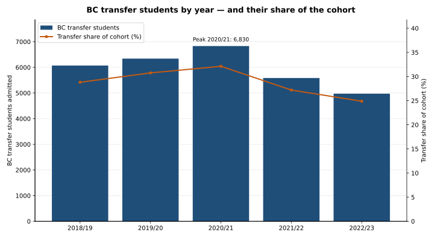
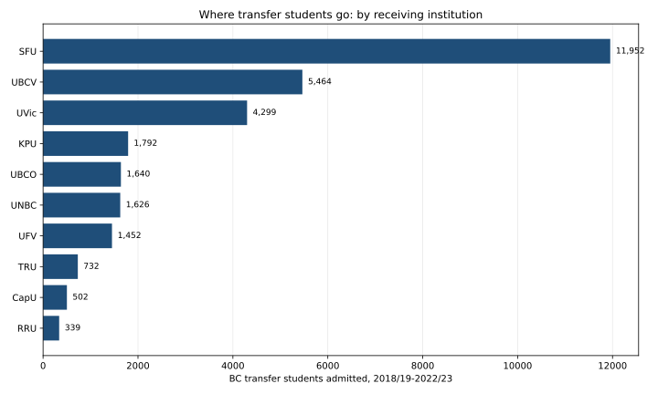
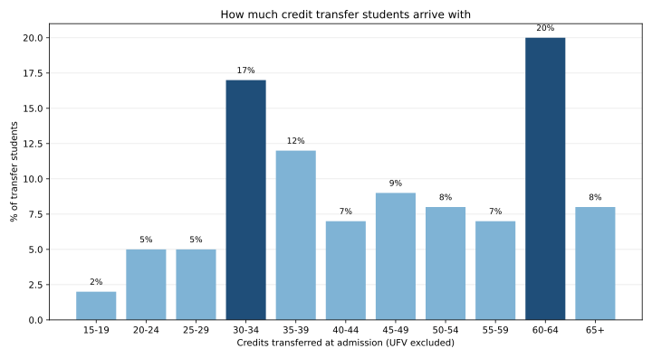
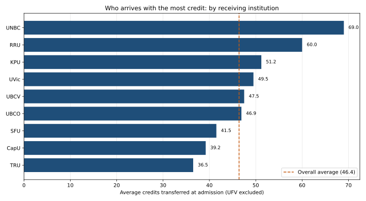

# College-to-university transfers in BC

**Question: how do BC college students move into universities, and how
well do they do once there?**

## Executive summary



**BC's transfer pathway is alive but narrowing: transfer numbers peaked
in the pandemic year and have fallen 27% since — yet transfer students
still outperform direct entrants, completing degrees at higher rates
and matching them on time-to-degree once credits are equalized.**

"Transfer student" here means what BCCAT means: a student transferring
15 or more credits from a BC Transfer System member institution into one
of BC's public universities. "Direct entry" means entering a university
after graduating from a BC high school.

## Findings

### 1. Volume: a pandemic peak, then a 27% fall

| Year | Transfer students | Direct entry | Transfer share |
|------|------------------:|-------------:|---------------:|
| 2018/19 | 6,070 | 14,999 | 28.8% |
| 2019/20 | 6,340 | 14,277 | 30.7% |
| 2020/21 | 6,830 | 14,432 | 32.1% |
| 2021/22 | 5,585 | 14,951 | 27.2% |
| 2022/23 | 4,974 | 15,021 | 24.9% |
| **5-year total** | **29,798** | **73,680** | **28.8%** |

Transfer students were 29% of the combined cohort over the five years
(the report rounds the share to 29%). Direct-entry numbers, by contrast,
ended the period essentially flat (14,999 in 2018/19, 15,021 in 2022/23)
— so the transfer share fell from its 32.1% peak in 2020/21 to 24.9% in
2022/23.

### 2. Where they go: SFU takes two in five



| Receiving institution | Transfer students | Share of all transfers | Transfer share of its own intake |
|-----------------------|------------------:|-----------------------:|---------------------------------:|
| Simon Fraser University | 11,952 | 40.1% | 45.2% |
| UBC Vancouver | 5,464 | 18.3% | 23.2% |
| University of Victoria | 4,299 | 14.4% | 28.7% |
| Kwantlen Polytechnic University | 1,792 | 6.0% | 24.5% |
| UBC Okanagan | 1,640 | 5.5% | 24.1% |
| University of Northern BC | 1,626 | 5.5% | 50.7% |
| University of the Fraser Valley | 1,452 | 4.9% | 19.5% |
| Thompson Rivers University | 732 | 2.5% | 18.9% |
| Capilano University | 502 | 1.7% | 5.3% |
| Royal Roads University | 339 | 1.1% | 86.5% |

Two patterns stand out. First, SFU alone absorbs 40% of all transfer
students. Second, at Royal Roads and UNBC, transfer students are the
majority of the intake (86.5% and 50.7%) — these are transfer destinations
by design, not overflow valves.

### 3. Where they come from: one pipeline dominates

Mainland/Southwest senders account for 21,237 students — 71.3% of all
transfer students (up from 68% last period, partly because three more
Mainland/Southwest receivers joined the study). Of those, 13,346 came
from public institutions and 7,891 from private ones.

| Top sending institution | 5-year total | Top destination |
|-------------------------|-------------:|-----------------|
| Fraser International College (private) | 4,923 | SFU (4,817 — 98%) |
| Langara College | 4,013 | UBC Vancouver (1,860) |
| Douglas College | 3,611 | SFU (2,122) |
| Camosun College | 2,440 | UVic (2,045) |
| Kwantlen Polytechnic University | 1,784 | SFU (994) |
| Okanagan College | 1,268 | UBC Okanagan (865) |
| Coquitlam College (private) | 1,144 | UVic (339) |
| Capilano University | 1,136 | UBC Vancouver (466) |
| College of New Caledonia | 1,130 | UNBC (1,001 — 89%) |
| Thompson Rivers University | 1,031 | SFU (211) |
| Alexander College (private) | 782 | UBC Vancouver (310) |
| Selkirk College | 494 | UVic (184) |

The single biggest pipeline in BC transfer is Fraser International
College into SFU: 4,817 students, nearly the entire output of the
province's largest sender. The northern pipeline is just as concentrated:
89% of College of New Caledonia's transfer students go to UNBC.

### 4. How much credit they arrive with: two entry points



Students cluster at two entry points: 30–34 credits (17%, the start of
second year) and 60–64 credits (20%, the start of third year). The
distribution is otherwise spread thin — no other band tops 12%.

Two shifts matter:

- **The 65+ band nearly doubled** versus the previous report: 2,203
  students arrived with 65 or more credits, versus 1,079 before. Degree
  partnerships (e.g., in nursing) that transfer large completed blocks
  are a likely explanation, per the report.
- **Region changes the picture.** Private Mainland/Southwest students
  skew early (39% arrive with 30–34 credits — the FIC-to-SFU pattern),
  while Cariboo-North students skew late (52% arrive with 65+ credits).

The credit-band tables exclude UFV (data unavailable), so they cover
28,346 students; adding UFV's 1,452 reconciles exactly to 29,798.

### 5. Average credits: the north arrives with the most



Overall, transfer students arrived with an average of 46.4 credits —
down from 48.6 in the previous period. By receiver (UFV excluded):

| Receiving institution | Average credits |
|-----------------------|----------------:|
| UNBC | 69.0 |
| Royal Roads | 60.0 |
| KPU | 51.2 |
| UVic | 49.5 |
| UBC Vancouver | 47.5 |
| UBC Okanagan | 46.9 |
| SFU | 41.5 |
| CapU | 39.2 |
| TRU | 36.5 |

UNBC's 69.0 reflects its northern feeders: College of New Caledonia
students arrive with 69.3 credits on average, and Cariboo-North as a
region averages 66.3. At the other end, TRU's 36.5 and CapU's 39.2 show
receivers whose transfer students arrive earlier in their programs.
Public Mainland/Southwest senders average 47.4 credits versus 38.7 for
private ones — and Fraser International College just 35.6.

### 6. Performance: transfer students finish more, just as fast

| Measure | Transfer students | Direct entry |
|---------|------------------:|-------------:|
| Degree completion | 75.5% (4,382 of 5,802) | 68.0% (7,566 of 11,122) |
| Time at receiving institution to a credential | 37.6 months | 53.0 months |
| Time from 60 credits to graduation | 29.6 months | 29.2 months |

The completion comparison uses different cohorts by design: transfer
students admitted in 2018/19 versus direct-entry students admitted in
2016/17, matched for time spent at the receiving institution. KPU's
direct-entry data were unavailable, so the direct-entry cohort excludes
KPU. The report's text rounds these rates to 75% and 67%; its Table 31
prints 76% and 68%; the exact divisions are 75.5% and 68.0%, which is
what this project uses.

By receiver, transfer completion was highest at UBC Vancouver (87%),
Royal Roads (84%), and UBC Okanagan (84%), and lowest at KPU (46%) —
while CapU's 57% rests on a small 2018/19 cohort (about 25 students),
so treat it as noisy. By sending region, Thompson-Okanagan-Kootenay
led at 80%; Out-of-Province trailed at 61%.

On grades: transfer students' admission GPAs were typically lower than
direct entrants' — but the two are not comparable (post-secondary GPA
versus high-school GPA). After 15 credits at the receiving institution,
transfer students' average GPAs were higher than direct entrants' at
every receiver except UBCV. At graduation, transfer GPAs were higher at
Royal Roads (3.7 versus 3.4) and comparable elsewhere.

The time finding is the cleanest of all: transfer students finish their
credential in 37.6 months at the receiver versus 53.0 for direct entry
(expected — they arrive with up to two years already done), but once
both groups have 60 credits, they graduate in the same time: 29.6 versus
29.2 months. The previous period had a 9-month gap on that controlled
measure; it has now closed.

Transfer graduates skew to the Arts: 44% completed a Bachelor of Arts
(versus 32% of direct-entry graduates) and 18% a Bachelor of Science
(versus 33%). Health drew 14% of transfer graduates versus 9% of direct
entry.

### 7. Who transfer students are

- Average age 22.2 versus 18.1 for direct entry — though the transfer
  cohort was younger than in the previous period.
- 54% female versus 56% for direct entry.
- 3% self-identified as Indigenous in both groups (transfer down from
  4% last period).
- 31% international versus 9% for direct entry (up from 27.1% and 4.4%).
- 55% enrolled in Arts and Sciences versus 58% for direct entry.

### 8. Change versus the previous period (2013/14–2017/18)

| Measure | 2013/14–2017/18 | 2018/19–2022/23 |
|---------|----------------:|----------------:|
| Transfer students (5 years) | 30,140 | 29,798 |
| Transfer share of cohort | 36% | 29% |
| Average credits at admission | 48.6 | 46.4 |
| Students arriving with 65+ credits | 1,079 | 2,203 |
| Degree completion, transfer / direct | 72% / 60% | 75.5% / 68.0% |

Read the share decline with care: the study's scope expanded from 6
research-intensive universities to all 10 public universities, and UBC
was split into two campuses — so the two periods are not like-for-like,
and the report attributes part of the share decline to that expansion.
The previous period's total also appears as 30,104 in the 2020 report
itself; this project uses the 2024 report's comparison figure of
30,140 (the 36-student difference reflects the 2020 report's July 2020
table revisions).

For scale, BCCAT's 2024-25 Annual Review (citing the Student
Transitions Project) puts the whole system at roughly 400,000 credits
transferred each year, 50,000 learners moving between public
institutions annually, and 45% of degree graduates having attended more
than one public institution. Note the definitions differ: the STP
counts "movers" while this report counts students transferring 15 or
more credits, so the two are not directly comparable.

## How to run

```bash
pip install -r requirements.txt
python analysis.py   # prints findings, writes charts to charts/
pytest               # 8 tests: transcription checks against the report's
                     # own totals, plus computation checks
```

## SOURCES — the table behind every file

All data come from BCCAT, *Profile and Performance of BC Transfer
Students (2018/19–2022/23)*, January 2025
(www.bccat.ca/publication/BCTransferStudents2024). The report is
PDF-only, so its tables were transcribed into `data/`; the tests check
each transcription against the report's own published totals.

| File | Report table |
|------|--------------|
| `data/transfer_by_year.csv` | Table 2, total rows |
| `data/transfer_by_receiver.csv` | Table 3, total rows |
| `data/top_senders.csv` | Tables 2 (totals) and 3 (top destination per sender) |
| `data/transfer_by_region.csv` | Table 2, region totals |
| `data/credit_bands.csv` | Tables 5 (percentages) and 6 (counts) |
| `data/avg_credits_by_receiver.csv` | Table 7, "Overall BC Transfer Students" row |
| `data/completion_by_receiver.csv` | Table 31, "Total BC Transfer Students" row (graduates and percentages; admitted counts derived from those two) |

## Limitations — read before citing

- **Transcribed from PDF.** The report publishes no machine-readable
  tables. Every figure here was read from the PDF's tables and checked
  against the report's own totals in the test suite — but a
  transcription error in an untested cell remains possible. The
  published totals the tests check: 29,798 transfer / 73,680 direct
  students; credit-band counts summing to 28,346 (+ UFV's 1,452);
  completion graduates summing to 4,382.
- **Privacy masking.** Cells based on fewer than 10 students are masked
  as `X` or `<10`, and totals next to a masked cell are rounded to the
  nearest 5 and marked with an asterisk. That rounding explains the
  small gaps in this project: the yearly transfer figures sum to 29,799
  against the published 29,798, and the derived completion cohorts sum
  to 5,809 against the published 5,802.
- **UFV is missing from three tables.** UFV's data were unavailable for
  the credit-band, average-credit, and completion tables, so those cover
  9 receivers, not 10. UFV's 1,452 transfer students are included in the
  volume, receiver, and sender tables.
- **Completion cohorts differ by design.** Transfer students admitted in
  2018/19 are compared with direct-entry students admitted in 2016/17,
  matched for time at the institution — not the same admission year.
  KPU's direct-entry data were unavailable.
- **Period comparisons are not like-for-like.** The 2024 study covers 10
  receiving institutions (including CapU, KPU, UFV) and splits UBC into
  two campuses; the 2020 study covered 6 research-intensive
  universities. The transfer-share decline partly reflects that scope
  change.
- **Licence:** see `LICENSE` (CC BY-NC 4.0 — academic demonstration
  only, no commercial use). BCCAT's report is © BCCAT, January 2025.
